import { Steps } from "@astrojs/starlight/components";

Label templates let you design your own labels: text, data fields, barcodes, shapes and images laid out on a real
label size. Items and locations then print with the template on a label printer, in the browser, or as a PDF sheet.

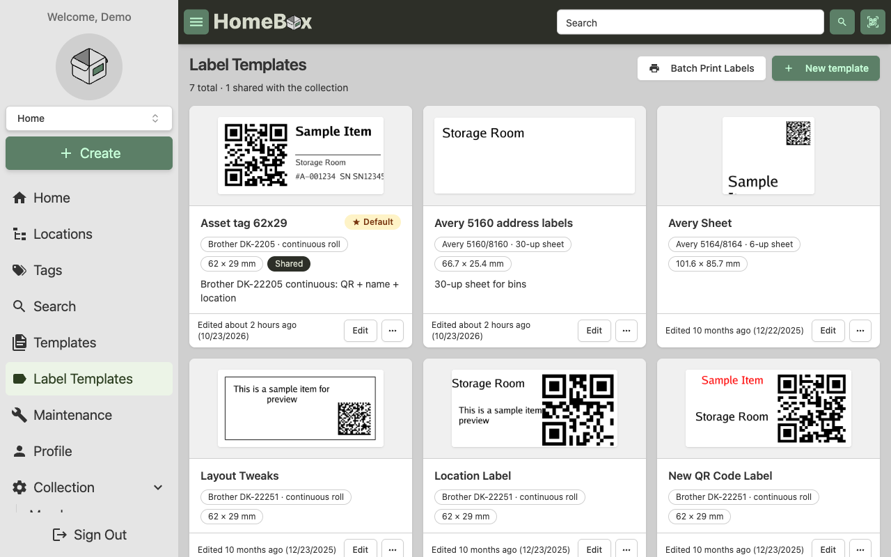

Open **Label Templates** in the sidebar to see your designs. Each card shows a rendered sample, the label stock it is
made for and whether it is shared with the collection. The star badge marks your **default template**, the one that
**Quick print** uses. Choose it from a card's menu. The default is a personal preference synced with your account, so
every member of the collection can pick their own.

## Create a template

<Steps>

1. Click **New template**.
2. Name it and pick a **label preset**: Avery sheet labels, Brother DK rolls, Dymo and Brady die-cut labels and Zebra
   stock are included. Pick **Custom** to type any width and height in millimetres.
3. Leave the resolution at 300 dpi unless your printer needs something else.
4. Click **Create**. The editor opens with an empty label at the chosen size.

</Steps>

> [!TIP]
> Choose the preset that matches the label stock you have loaded. The template then prints edge to edge without
> scaling.

## The editor

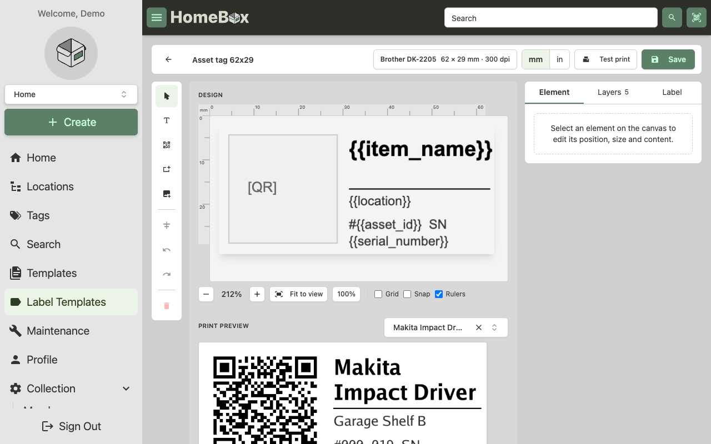

The editor has three parts:

- **Tool rail** (left): add text, a barcode, a rectangle or line, or an image. Below it: align the selection against
  the label edges, undo and redo, and delete.
- **Canvas** (middle): the label at real proportions with rulers. Drag elements to move them, drag the handles to
  resize, double-click text to edit it. Zoom controls, grid, snap-to-grid and rulers sit under the canvas. The
  **Print preview** under the canvas shows the label rendered by the server for a real item.
- **Inspector** (right): tabs for the selected **Element**, the **Layers** list and the **Label** itself.

The header shows the label stock and size, a **mm / in** switch that changes every measurement in the editor, a
**Test print** button and **Save**. An amber **Unsaved changes** badge appears as soon as you edit something, and the
browser warns you before you leave with unsaved work.

### Working with elements

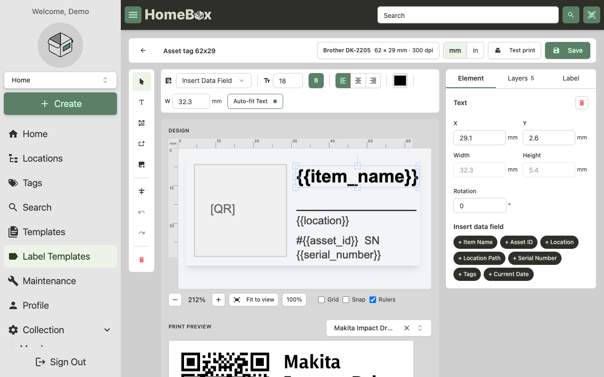

Selecting an element opens its properties in the **Element** tab: position, size and rotation in the unit you chose.
Text elements also get a formatting toolbar above the canvas (size, bold, alignment, colour, box width) and an
**Auto-fit** switch that shrinks the font until the text fits its box, which keeps long item names on the label.

Text can mix fixed words with **data fields** in double braces, for example `Asset #{{asset_id}}`. Use the **Insert
data field** menu in the toolbar or the chips in the Element tab:

| Field | Prints |
| --- | --- |
| `{{item_name}}`, `{{description}}`, `{{notes}}` | The item's name, description and notes |
| `{{asset_id}}`, `{{serial_number}}`, `{{model_number}}`, `{{manufacturer}}` | Identification fields |
| `{{location}}`, `{{location_path}}` | The item's location and its full path, for example `Garage > Shelf B` |
| `{{tags}}`, `{{quantity}}` | Comma-separated tags and the quantity |
| `{{item_url}}`, `{{location_url}}` | Links back to HomeBox, handy inside a QR code |
| `{{custom_<name>}}` | Any custom field, by name |
| `{{current_date}}`, `{{current_time}}` | When the label was printed |

Location labels use `{{location_name}}`, `{{location_path}}`, `{{item_count}}` and `{{location_url}}`.

**Barcodes** are added from the tool rail. Pick the symbology (QR code, DataMatrix, Code 128, Code 39, EAN-13, EAN-8
or UPC-A) and what it should encode. Only compatible sources are offered: a numeric-only symbology such as EAN cannot
encode a URL, so it lists the asset id only. The canvas shows a placeholder; the print preview shows the real code.

**Images** such as a logo are embedded in the template, so keep them small (under 512 KB). PNG, JPEG and GIF work.

### Layers and the Label tab

The **Layers** tab lists every element, top layer first. Click a row to select it, use the eye to hide it from the
print, and the arrows to change the stacking order.

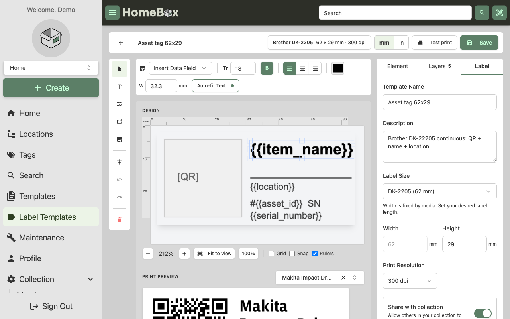

The **Label** tab holds everything about the template itself: its name and description, the preset and size,
orientation, print resolution and the **Share with collection** switch. Display settings for rulers, grid and snap
live at the bottom.

### Preview and test print

Pick an item in the **Print preview** panel and the server renders the label with that item's data every time you
stop editing for half a second. This is exactly what will print. **Test print** sends one copy of that preview label
through the server's print command (see [Server-side printing](#server-side-printing)); it saves the template first if
there are unsaved changes. If no print command is configured, the button tells you that server-side printing is not
set up and you need to ask your administrator.

### Keyboard shortcuts

| Keys | Action |
| --- | --- |
| Arrow keys, Shift + arrows | Nudge the selection by 1 px or 10 px |
| Delete or Backspace | Remove the selection |
| ⌘Z / Ctrl+Z, ⇧⌘Z / Ctrl+Y | Undo, redo |

On a phone the editor stacks: canvas on top, the add-element row below it, then the inspector tabs.

## Printing

### From an item or location

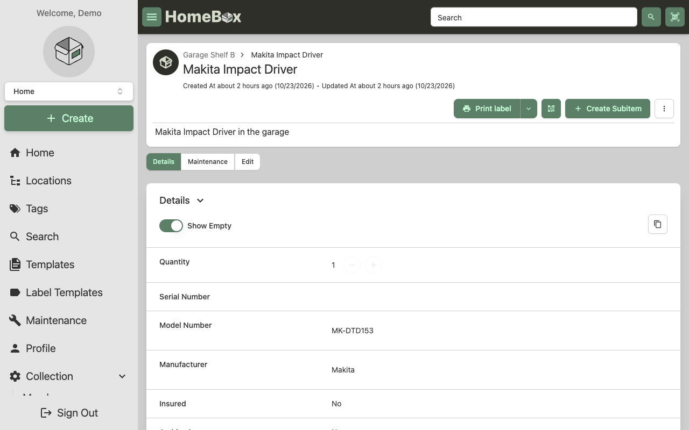

Every item and location has a **Print label** button. The main part does the quickest thing: when you have a default
template and the server has a label printer configured, one click prints a single label. Otherwise it opens the print
dialog instead.

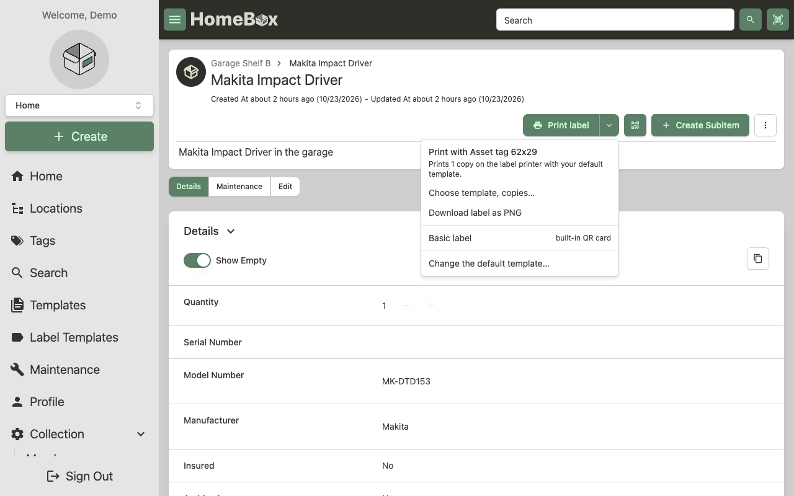

The arrow opens more options:

- **Print with &lt;template&gt;**, the one-click quick print with your default template on the server's label printer.
- **Choose template, copies…** opens the print dialog.
- **Download label as PNG** renders the label with your default template.
- **Basic label** opens HomeBox's built-in QR label card, which needs no template at all.

The QR button next to it still shows a QR code for the page you are on.

### The print dialog

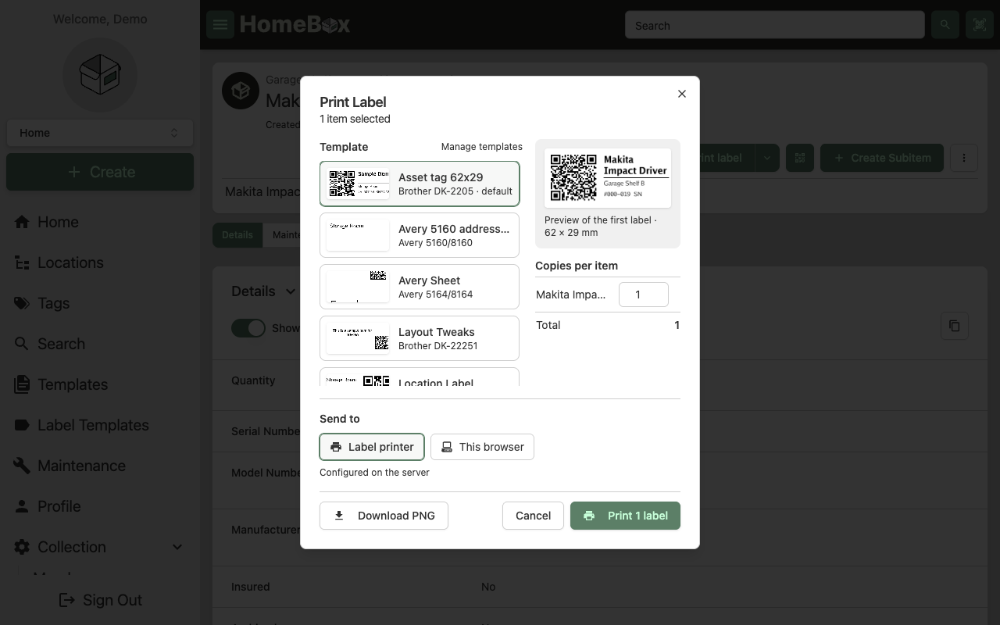

Templates are shown as cards with a sample, so you can tell them apart at a glance; your default is pre-selected.
The preview on the right is rendered with the first selected item. Set the number of copies per item, then choose
where to send the labels:

- **Label printer**, the printer attached to the HomeBox server. It only appears when the administrator has set a
  print command, and it is greyed out for sheet templates because the server prints one label at a time. When it is
  not available the dialog tells you to ask your administrator.
- **This browser**, which opens the label in a print window.
- **Download** saves a PNG, or a PDF when there is more than one label or the template is a sheet.

### Several at once

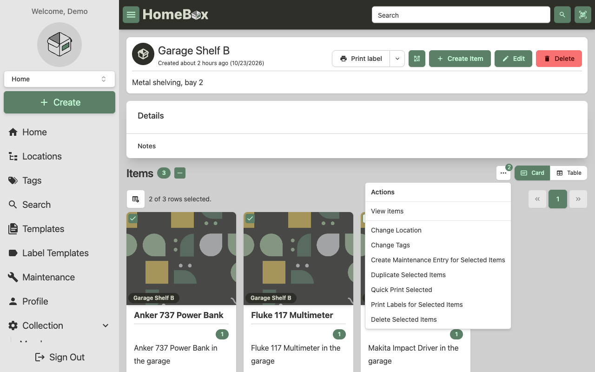

Select items in any list (home, search, a location or a tag) and open the **⋯** actions menu. **Print labels for
selected items** opens the same dialog with a copies field per item. **Quick Print Selected** prints one label per
selected item with your default template on the server's label printer, without opening the dialog.

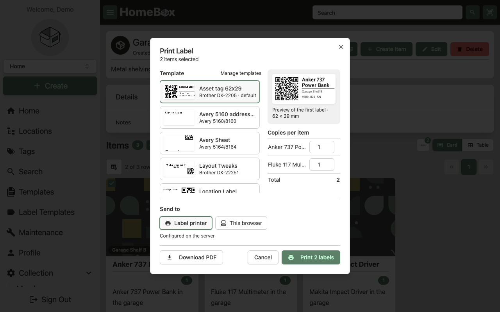

### Batch print

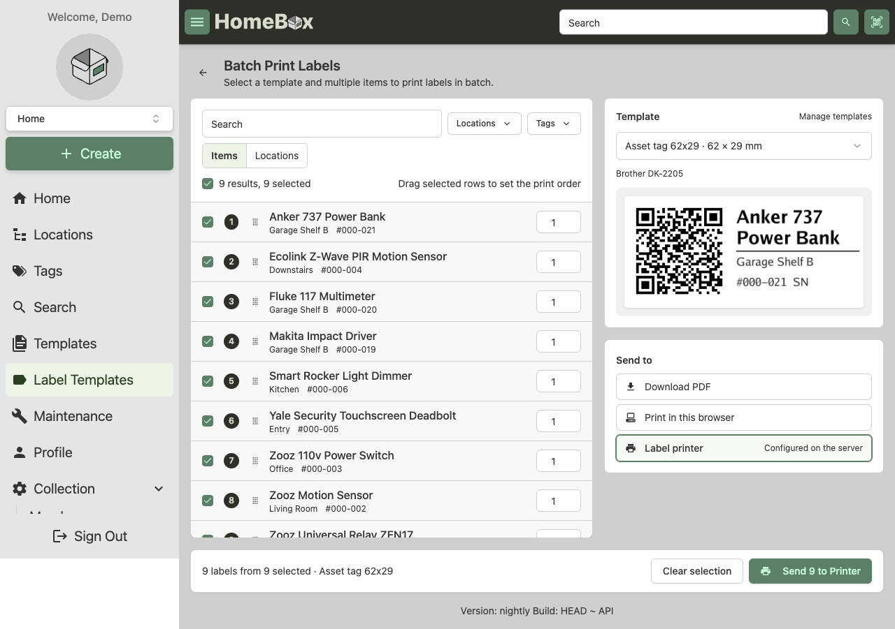

**Label Templates › Batch print** is for bigger jobs. Search and filter items (or switch to **Locations**), tick what
you want, set copies per row and drag the selected rows into the order you want them printed. The right column holds
the template, a preview and the destination (**Download PDF**, **Print in this browser** or **Label printer**); the
footer sums it up and prints or downloads.

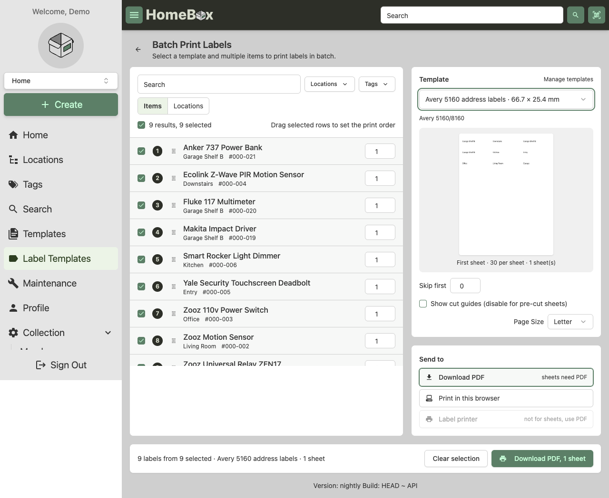

For **sheet templates** (Avery and similar) the preview shows the first sheet. **Skip first** leaves positions empty
on a partly used sheet, **cut guides** adds thin borders for plain paper, and you can pick Letter or A4. Sheets always
go out as PDF or through the browser; the label printer is greyed out because the server prints one label at a time.

> [!TIP]
> The classic **Asset ID label generator** under Collection › Tools still exists for pre-printing numbered QR labels
> before items are entered.

### Server-side printing

HomeBox does not talk to printers itself. To print from the server, the administrator sets
`HBOX_LABEL_MAKER_PRINT_COMMAND` in the environment or config file (it is not a UI setting). HomeBox renders the label
to a temporary PNG and runs that command once per copy, replacing `{{.FileName}}` with the file's path. The same
command also prints the built-in basic label. For example:

```sh
# Brother QL printer on the network, 62 mm tape
HBOX_LABEL_MAKER_PRINT_COMMAND="brother_ql -b network -p tcp://192.168.1.50 print -l 62 {{.FileName}}"

# A printer shared through CUPS
HBOX_LABEL_MAKER_PRINT_COMMAND="lp -d labelprinter {{.FileName}}"
```

Template labels can also use `{{.Width}}`, `{{.Height}}`, `{{.WidthMm}}`, `{{.HeightMm}}`, `{{.Dpi}}`, `{{.TitleText}}`,
`{{.URL}}` and `{{.Copies}}`. See the [configuration page](/en/quick-start/configure) for the full list.

Because the server does the printing, one tap prints from a phone or tablet too, with no browser print dialog, as long
as the administrator has set the command. If it is not set, the **Label printer** destination is hidden; use **This
browser** or **Download** instead, or ask your administrator.

## Tips

- Keep text inside the label with a small margin; label printers rarely print to the very edge.
- Give QR codes at least 15 mm on a 300 dpi printer so phones scan them from a shelf away.
- Use **Auto-fit** for item names and keep fixed-size text for labels such as "SN".
- Make one template per label stock and share it with the collection; duplicate it to try variations.
- **Export JSON** in a template's menu saves the design to a file you can keep or share.

## Troubleshooting

**Labels do not line up on a sheet.** Use the preset for your exact Avery number, turn off cut guides, and print the
PDF at 100% scale (no "fit to page").

**A barcode will not scan.** Check the symbology supports the data: EAN and UPC need digits only. Make the barcode
larger and keep white space around it.

**The label printer does not print.** HomeBox runs the print command and reports an error if it fails, so check the
server log first. Then run the same command by hand on the server, with a PNG file in place of `{{.FileName}}`. The
file HomeBox passes is a PNG at the template's DPI, so the command and printer need to accept that. If the **Label
printer** destination is missing, no print command is configured.

**The preview does not update.** Pick a preview item first; without one there is nothing to render. Use **Refresh** if
the server was busy.
